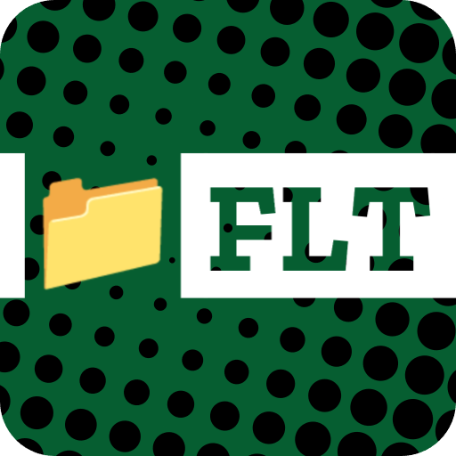
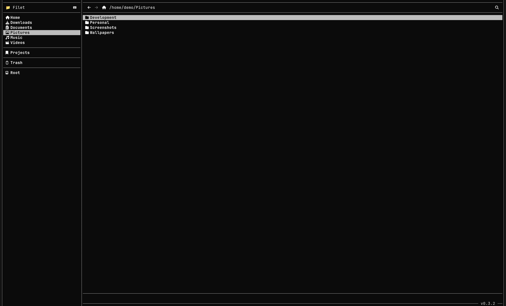
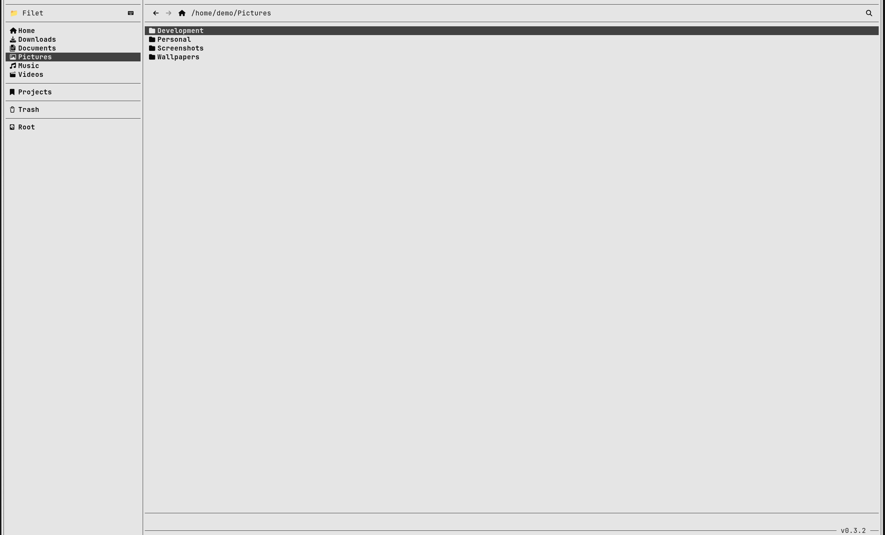
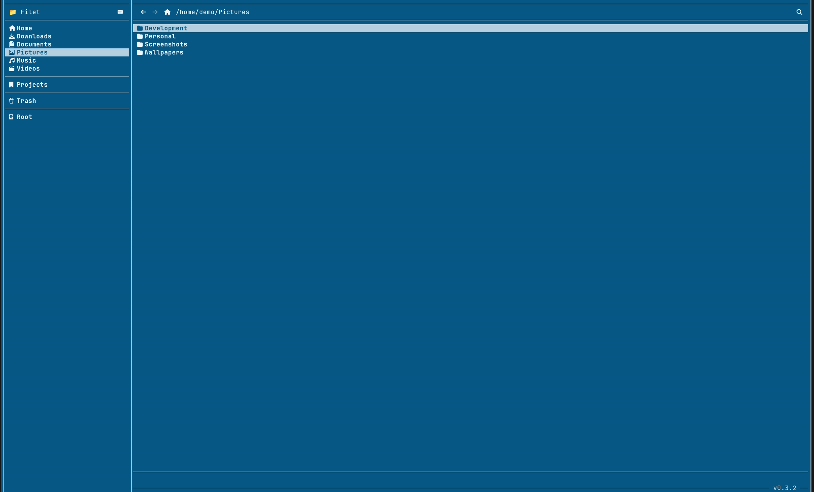
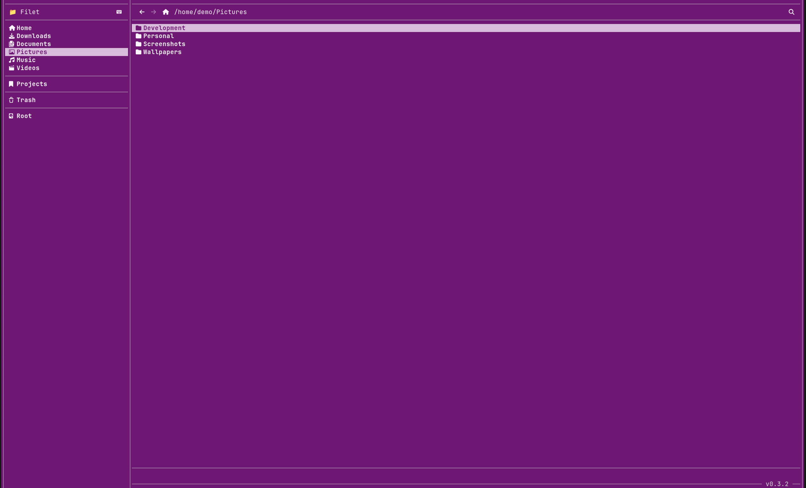

<p align="center">
  
</p>

# filet

Simple terminal file manager with first party mouse support. Built with OpenTUI on Bun.

## Disclaimers

- LLMs were used during development for research, prototyping, refactoring, and some code generation.
- This is beta software and bugs should be expected. Use at your own risk.
- A Nerd Font is required for icon support.

## Requirements

- `tar` for extracting and creating tar archives, `unzip` for extracting `.zip` archives and `zip` for creating them. Supported formats are `.tar`, `.tar.gz`, `.tgz`, `.tar.xz`, `.txz`, `.tar.bz2`, `.tbz2`, `.tar.zst`, `.tzst` and `.zip`.
- `gzip`, `xz`, `bzip2` and `zstd` for `.tar.gz`, `.tar.xz`, `.tar.bz2` and `.tar.zst` archives respectively.
- [ripdrag](https://github.com/nik012003/ripdrag) for drag and drop with `W`.

## Features

- Browse folders with back and forward history and an editable path bar.
- Open a folder, or a file's folder with the file selected, with `filet <path>`.
- Search the current folder by name as you type.
- Preview text files with syntax highlighting, and images, in a sidebar.
- Show the properties of a file or folder, such as its size, permissions and dates.
- List every keyboard shortcut and mouse control with `?`.
- Open files in their default application, or run them if they're executable.
- Create, copy, cut, paste, rename, trash and delete files and folders.
- Replace, skip or keep both when a pasted item already exists.
- Restore items from the trash, or empty it.
- Extract and create `.tar`, `.tar.gz`, `.tar.xz`, `.tar.bz2`, `.tar.zst` and `.zip` archives.
- Drag and drop files and folders into other applications with `ripdrag`.
- Open a terminal in the current folder, or in any folder from its context menu.
- Copy the paths of files and folders to the system clipboard.
- Move with the arrow keys or `H`, `J`, `K` and `L`, and act with single letter shortcuts.
- Nerd Font file icons and context menus.
- Mount, unmount and eject drives from the sidebar.
- Bookmarks and themes, set in a config file.
- First party mouse support.
- Pick files and folders for other applications as a [file chooser](#file-chooser).

## Screenshots

<table>
  <tr>
    <td>
        
    </td>
    <td>
        
    </td>
  </tr>
  <tr>
    <td>
        
    </td>
    <td>
        
    </td>
  </tr>
</table>

## Configuration

filet works without a config file. To change its defaults, create a config file at:

```
~/.config/filet/config.toml
```

Values in your user config take priority over the defaults, and any values you leave out fall back to the defaults. Paths can start with `~` for your home folder. For example:

```toml
bookmarks = [
    {label = "Projects", mount = "/home/<user>/Projects"},
]

trash_path = "/home/<user>/.local/share/Trash"

logs_path = "/home/<user>/.local/state/filet/logs"

double_click_timeout = 250

sidebar_width = 34

preview_width = "30%"

terminal = "kitty"

[theme]
bg = "#0C0C0C"
fg = "#fafafa"
border = "#d4d4d4"
success = "#16a34a"
danger = "#dc2626"
accent = "#0369a1"
```

`terminal` is the command run by `O` and the Open in Terminal menu items, started in the current folder, or in the folder you right clicked. It can include arguments, such as `"kitty --single-instance"`, which are split on spaces. When an argument or the path to the terminal contains spaces, use a list instead, such as `["kitty", "--title", "My Terminal"]`. Without it, or when it's invalid, filet uses `$TERMINAL`, then [`xdg-terminal-exec`](https://gitlab.freedesktop.org/terminal-wg/specifications). If the folder can't be opened, or the terminal can't be started or quits with an error within 2 seconds, the footer says so and the error is logged.

`sidebar_width` and `preview_width` set the widths of the sidebar and the preview sidebar. Each is either a number of columns, such as `40` or `"40"`, or a percentage of the terminal's width as a string, such as `"25%"`. They default to `34` and `"30%"`. An invalid width, such as `0`, `12.5` or `"150%"`, falls back to its default and is written to the error log. The sidebar still hides when the terminal is 100 columns wide or less, and the preview sidebar at 140 or less.

## File chooser

filet can be the Open and Save dialog for applications such as Firefox, through [xdg-desktop-portal-termfilechooser](https://github.com/hunkyburrito/xdg-desktop-portal-termfilechooser). Installing filet also installs `~/.local/bin/filet-wrapper.sh`, the script the portal runs. Set it as the portal's `cmd` in `~/.config/xdg-desktop-portal-termfilechooser/config`, with the full path, since the portal may not have `~/.local/bin` on its `PATH`:

```ini
[filechooser]
cmd=/home/<user>/.local/bin/filet-wrapper.sh
env=TERMCMD=kitty
```

`TERMCMD` is the terminal filet opens in, such as `kitty`, `foot` or `alacritty -e`. To float the chooser or give it its own window rules, give it an app id, such as `TERMCMD=kitty --app-id filet-chooser`. Without it, the wrapper uses `$TERMINAL`, then `xdg-terminal-exec`. Then make the portal the file chooser, for example with `org.freedesktop.impl.portal.FileChooser=termfilechooser` in `~/.config/xdg-desktop-portal/portals.conf`, and restart `xdg-desktop-portal`.

The footer shows what the application asked for and the keys to answer it, with Cancel and Choose buttons, or Save when saving, on its right. Choose does the same as `C`:

- **Open a file:** `Return` or a double click on a file chooses it. `C` chooses the selected file.
- **Open files:** mark files with `Space` or `Ctrl+click`, then press `C` or `Return` to choose them. With nothing marked, the selected file is chosen.
- **Choose a folder:** open the folder, then press `C`, or right-click a folder and choose Choose. When several folders can be chosen, `C` chooses the marked folders, or the current folder when none are marked.
- **Save a file:** filet opens in the suggested folder. When the portal has created the suggested file, which it does unless `create_help_file=0`, that file is selected and `Return` saves to it. Otherwise filet asks for a name straight away, filled in with the suggested one. `C` asks for a name to save under in the current folder. Saving onto another file that already exists, including a broken link, asks first.

The trash is hidden while choosing, and its folder can't be opened. `Q` cancels without a confirmation, and so does closing filet any other way. Run filet as a chooser yourself with `filet --chooser-file <out> [--multiple] [--directory] [--save] [path]`, which writes the chosen paths to `<out>`, one per line.

## Logs

Errors are saved to a file per day at `~/.local/state/filet/logs/YYYY-MM-DD.jsonl`, or in the folder set by `logs_path`. Each line is a JSON object with a local `timestamp`, the error `message`, and the `code`, `errno`, `syscall` and `path` where available, for example:

```json
{"timestamp":"2026-09-29T14:03:12.345+02:00","code":"EEXIST","syscall":"mkdir","path":"/home/<user>/archive","message":"EEXIST: file already exists, mkdir '/home/<user>/archive'"}
```

To read a day's logs with [jq](https://jqlang.org):

```
jq . ~/.local/state/filet/logs/2026-09-29.jsonl
```

## Controls

### Mouse

| Action         | Target         | Result                                                                                                      |
| -------------- | -------------- | ----------------------------------------------------------------------------------------------------------- |
| `Left click`   | File or folder | Select it. Files are shown in the preview sidebar while it is open.                                         |
| `Double click` | File or folder | Open it. Folders open in the explorer, and files in their default application, or run if executable. Folders in the trash don't open. |
| `Ctrl+click`   | File or folder | Mark or unmark it, and select it.                                                                           |
| `Right click`  | File or folder | Open its context menu.                                                                                      |
| `Right click`  | Explorer       | Open the explorer context menu.                                                                             |
| `Left click`   | Sidebar link   | Select and navigate to it.                                                                                  |
| `Left click`   | Sidebar drive  | Open it, mounting it first if it isn't mounted.                                                             |
| `Right click`  | Sidebar drive  | Open its menu to open, mount, eject or unmount it.                                                          |

### Keyboard

| Key            | Action                                                                                         |
| -------------- | ---------------------------------------------------------------------------------------------- |
| `Return`       | Open the selected file or folder, the same as a double click. Folders in the trash don't open. |
| `Space`        | Mark or unmark the selected file or folder, then select the entry below.                       |
| `Escape`       | Clear the marks, or the selection when nothing is marked.                                      |
| `Up` / `K`     | Select the entry above, scrolling it into view. With nothing selected, select the last entry.  |
| `Down` / `J`   | Select the entry below, scrolling it into view. With nothing selected, select the first entry. |
| `Left` / `H`   | Go up to the parent folder, selecting the folder you came from. Stops at the top of the trash. |
| `Right` / `L`  | Open the selected folder. Does nothing in the trash.                                           |
| `P`            | Open or close the preview sidebar.                                                             |
| `I`            | Show the properties of the selected file or folder.                                            |
| `Ctrl+X`       | Cut the marked items, or the selected file or folder.                                          |
| `Ctrl+C`       | Copy the marked items, or the selected file or folder.                                         |
| `Ctrl+V`       | Paste the cut or copied items into the current folder, asking about names that already exist. |
| `Y`            | Copy the paths of the marked items, or the selected file or folder, to the system clipboard.   |
| `Ctrl+R`       | Refresh the current folder, keeping the selection.                                             |
| `R`            | Rename the selected file or folder.                                                            |
| `N`            | Create a new file in the current folder.                                                       |
| `F`            | Create a new folder in the current folder.                                                     |
| `T`            | Move the marked items, or the selected file or folder, to trash, after confirmation.           |
| `Ctrl+Z`       | Restore a file or folder from trash, after confirmation, asking if its location is taken.      |
| `Delete` / `D` | Permanently delete the marked items, or the selected file or folder, after confirmation.       |
| `E`            | Extract the selected archive into a folder next to it. See [Requirements](#requirements).      |
| `A`            | Compress the marked items or selection into a new archive. See [Requirements](#requirements).  |
| `O`            | Open a terminal in the current folder. See [Configuration](#configuration).                    |
| `W`            | Drag and drop the marked items or selection with `ripdrag`. See [Requirements](#requirements). |
| `C`            | In [File chooser](#file-chooser) mode, choose the selection or current folder, or save here.  |
| `Q`            | Quit the application, after confirmation.                                                      |
| `?`            | Show the keyboard shortcuts and mouse controls.                                                |

In the path bar, `Escape` stops editing and shows the current folder again. Prompt modals focus their input when they open. In confirmation and prompt modals, `Return` confirms and `Escape` cancels. The properties modal closes with `Return` or `Escape`. The controls modal closes the same way, and scrolls with the arrow keys, `J`, `K`, `PageUp`, `PageDown`, `Home` and `End`.

## Theming

Besides the default dark theme, here are a few others to try. Copy one into your `~/.config/filet/config.toml`, replacing the existing `[theme]` section. Or create your own theme.

Tip: See the [tailwind](https://tailwindcss.com/docs/colors) color pallet.

Colours are hex values, such as `#fafafa`, `#fff` or `#fafafaff`. An invalid colour falls back to its default. Invalid colours, unknown keys, and a `[theme]` or `[theme.syntax]` that isn't a table are written to the error log.

Besides `bg`, `fg`, `border`, `success` and `danger`, a theme can set:

- `accent`: the highlight for marked entries. Defaults to `#0369a1`.
- `surface`: the background of menus, prompts and confirmations. Defaults to `bg`, made fully opaque.

Set `bg = "transparent"` to use your terminal's own background. `surface` then defaults to black when `fg` is light and white when it is dark, so set it to match your terminal. A partly transparent `bg`, such as `#0c0c0c80`, keeps menus and modals opaque in its own colour.

Code previews use a light syntax highlighting palette when `bg` is a light color, and a dark one otherwise. With `bg = "transparent"`, the palette follows `fg` instead: dark when `fg` is light, and light when it is dark. Any of its colours can be overridden:

```toml
[theme.syntax]
keyword = "#ff7b72"
string = "#a5d6ff"
comment = "#8b949e"
number = "#79c0ff"
function = "#d2a8ff"
type = "#ffa657"
```

### Ivory

```toml
[theme]
bg = "#e5e5e5"
fg = "#0a0a0a"
border = "#262626"
success = "#16a34a"
danger = "#dc2626"
accent = "#0369a1"
```

### Sky

```toml
[theme]
bg = "#075985"
fg = "#f0f9ff"
border = "#d4d4d4"
success = "#16a34a"
danger = "#dc2626"
accent = "#ec4899"
```

### Fuchsia

```toml
[theme]
bg = "#701a75"
fg = "#fdf4ff"
border = "#d4d4d4"
success = "#16a34a"
danger = "#dc2626"
accent = "#0369a1"
```

## Building

filet uses Bun as its runtime, package manager, and bundler.

Install dependencies:

```
bun install
```

Build a standalone binary:

```
bun run build
```

This produces a binary at `dist/filet`.

`bun run archive` then packs the binary, the install script and the icon into `dist/Release <version>.tar.xz` for a release.

## Installing

After building, install the binary and desktop entry with:

```
bun run install:app
```

This copies the binary to `~/.local/bin/filet`, the [file chooser](#file-chooser) wrapper to `~/.local/bin/filet-wrapper.sh`, and adds a desktop entry at `~/.local/share/applications/filet.desktop` for application launchers. The entry accepts a path and registers filet for folders, so it can be chosen with Open With in other applications. Add `~/.local/bin` to your `PATH` to run `filet` directly from a terminal.

By default the launcher picks the terminal filet opens in. To choose it yourself, pass a terminal command, which filet's path is added after:

```
bun run install:app --terminal "kitty --app-id filet"
```

Giving the window its own app id, as `kitty --app-id filet` or `alacritty --class filet -e` do, lets your window manager's rules match it, for example to make filet a floating window. The choice is saved in the desktop entry and reused by later installs, and `--terminal ""` goes back to letting the launcher choose. When the install script runs in a terminal and no choice is saved yet, it asks for one. `./install.sh` takes the same option.

### From a release

You can also skip building and download the latest release from the [Releases](../../releases) page on GitHub.

Extract the archive.
```
tar -xvJf "Release 0.3.8.tar.xz" --one-top-level
```
cd Into the extracted directory.
```
cd "Release 0.3.8"
```
Run the install script.
```
./install.sh
```

This installs filet the same way as `bun run install:app`.

## Roadmap

- [x] Allow manually editing the current path.
- [x] Simple search function for the current directory.
- [x] Ability to open files marked as executables instead of previewing them.
- [x] Hide the sidebar when the viewport reaches a small enough size.
- [x] Option to restore a file from trash.
- [x] Add option to extract archives.
- [x] Improve overall theming support.
- [x] Virtualize the explorer list so directories with more than ~16,000 entries (e.g. `/nix/store`) load fully.
- [x] Directory and file preview modal.
- [x] Shortcuts cheat-sheet modal.
- [x] Add option to compress files/folders.
- [x] Add a name resolver to allow filesystem functions for files/folders with the same names.
